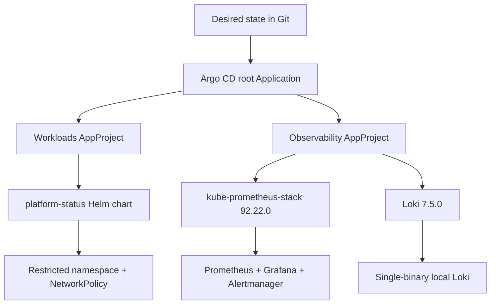

# Kubernetes GitOps Platform

A local-first GitOps reference project built around Helm, Argo CD, Kubernetes workload
hardening, monitoring, and logging. The repository stores desired state only—never
credentials or a kubeconfig.

> The Git source uses `example.invalid` until this repository is published. Argo CD
> cannot synchronize it accidentally before the real remote is intentionally configured.

## What this project demonstrates

- A hardened Helm workload with a JSON values schema
- Non-root containers, read-only root filesystem, seccomp, and dropped capabilities
- Readiness/liveness probes, resource limits, rolling updates, and a disruption budget
- Restricted Pod Security labels and deny-by-default network policy
- Argo CD app-of-apps reconciliation with automated drift correction
- Separate Argo CD projects and source/destination allowlists
- Multi-source Applications that keep upstream chart values in Git
- Pinned Prometheus, Grafana, Alertmanager, and Loki chart versions
- Local and CI rendering, schema validation, policy scanning, and secret detection

## Architecture



The workload project can deploy only the repository chart into `platform-status`. The
observability project allows only the two official chart repositories plus this Git
repository for values. Cluster-scoped access is enumerated for CRDs, RBAC, and admission
webhooks instead of using a wildcard. See [the architecture notes](docs/architecture.md).

## Local validation

Prerequisites:

- Docker Engine or Docker Desktop
- GNU Make

Run the complete credential-free suite:

```bash
make check
make clean
```

The suite performs:

1. Helm lint and values-schema validation.
2. Local workload rendering.
3. Strict Kubeconform validation of all seven rendered resources.
4. Trivy HIGH/CRITICAL Kubernetes policy checks.
5. Syntax processing of the Argo CD CRD resources.
6. Fresh rendering of pinned monitoring and Loki charts with repository values.

Gitleaks scans complete Git history in CI. Read [the validation record](docs/validation.md)
for the latest results and limitations.

## GitOps bootstrap boundary

Before bootstrap, replace every `https://example.invalid/kubernetes-gitops-platform.git`
value with the real public repository URL and review the diff:

```bash
rg -n "example\.invalid" bootstrap gitops
make check
```

Then follow [the runbook](docs/runbook.md). Argo CD v3.6.1 and Kind v0.33.0 are the
documented baseline. The repository deliberately does not automate UI credentials,
repository tokens, or production cluster access.

## Repository layout

```text
.
├── .github/workflows/ci.yml       # Read-only CI controls
├── bootstrap/                     # Kind topology and root Application
├── charts/platform-status/        # Hardened example workload
├── docs/                          # Architecture, runbook, and evidence
├── gitops/applications/           # Argo CD child Applications
├── gitops/projects/               # Source and destination boundaries
├── gitops/values/                 # Versioned upstream chart values
└── Makefile                       # Containerized validation workflow
```

## Secret handling

There are no committed Kubernetes `Secret` manifests. Upstream charts can generate
runtime-only Secrets inside the cluster; they are never exported back to Git. For future
application secrets, use a secret manager with External Secrets or encrypted SOPS files,
and keep the decryption key outside the repository. See [SECURITY.md](SECURITY.md).

## Next milestones

- Connect the real GitHub remote and replace the intentionally invalid source URL
- Complete a disposable Kind reconciliation test after the node image is available
- Add image signature verification with a Kubernetes admission policy
- Add a log collector and a sample Grafana dashboard for the workload
- Add promotion overlays for development and staging clusters
